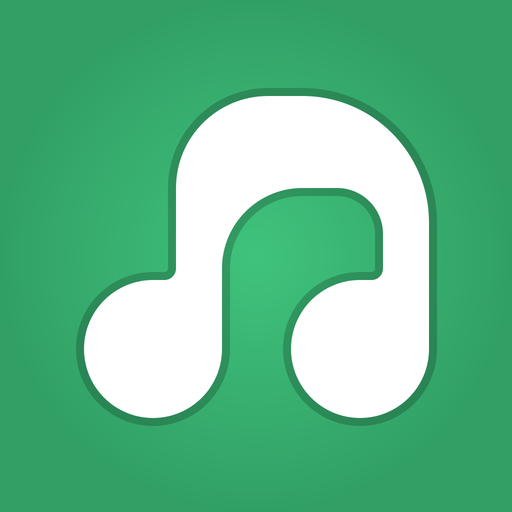

<p align="center">
  
</p>

<h1 align="center">Verre</h1>

<p align="center">
  A music app for Android in the style of Apple Music: YouTube Music as the main source, synced lyrics word by word,
  Liquid Glass surfaces and colors taken from the cover art.
</p>

<p align="center">
  
  
  
</p>

> [!NOTE]
> Verre is a fork of [YMusic V4](https://github.com/ymusic-io/YMusicV4) (GPL-3.0). The Kotlin packages stay
> `io.ymusic.*` on purpose, so upstream changes still merge. Verre is not affiliated with YMusic or YouTube.

## Goals

- **YouTube Music first**: the YT Music section is the home of the app.
- **Lyrics that work offline**: the lyrics are downloaded together with the song, and a song downloaded without
  them can get them later. Word-by-word lyrics (interactive, like Apple Music) are preferred, then line by line,
  then plain text.
- **Liquid Glass UI** on every button and surface, with a plain translucent fallback.
- **Apple Music design**: indexed cover art in every list, a dynamic gradient from the cover, large bold lyrics.

## Status

| Step | What                                         | State                          |
| ---- | -------------------------------------------- | ------------------------------ |
| 0    | Fork and rebrand                             | done, not compiled on a device |
| 1    | `:lyrics` core (parsers, selector, timeline) | done, tests                    |
| 2    | Providers, cache, LRCLIB `lyricsfile` words  | done, not run against LRCLIB   |
| 3    | Lyrics screen (word fill, estimated words)   | done, not compiled             |
| 4    | Liquid Glass                                 | partial (Glass.kt)             |
| 5    | Apple Music player, mini player, tab bar     | first pass, not compiled       |
| 6    | YouTube removed, YT Music only               | done, not compiled             |
| 7    | Listen Now / Browse / Library redesign       | next                           |

Details: [`PROGRESS.md`](PROGRESS.md) and [`PLAN.md`](PLAN.md).

## Debug APK from GitHub (no PC needed)

Actions -> **android-debug** -> Run workflow. When it ends, download the artifact `verre-debug-apk` from the run
page. The first run is slow (it builds ffmpeg and installs the NDK); the next ones use the cache. One ABI is built
(`arm64-v8a` by default).

## Building locally

Needs **JDK 17+**, **Node.js 22**, **CMake 3.20+**, the Android SDK with **NDK 28.2.13676358**, and FFmpeg from
[ffmpeg-build](https://github.com/ymusic-io/ffmpeg-build) checked out next to this repository (`../ffmpeg-build`,
at the commit in `FFMPEG_BUILD_REF` of [`android-debug.yml`](.github/workflows/android-debug.yml)).

```sh
./gradlew :androidApp:installDebug     # Android, on a connected device
./gradlew :lyrics:jvmTest              # lyrics core tests
./gradlew spotlessApply                # format
```

`VERRE_ANDROID_ABIS=arm64-v8a` (comma separated) builds the natives for those ABIs only.

Without `secrets.properties` the app does not talk to the upstream's services (remote config, updates, Sentry).

## Credits

- [YMusic V4](https://github.com/ymusic-io/YMusicV4) by ymusic-io, the base of this app (GPL-3.0).
- Lyrics ideas from [Better Lyrics](https://github.com/boidushya/better-lyrics), `@braccato/*` parsers (MIT) and
  [LRCLIB](https://lrclib.net).
- Liquid Glass: [Backdrop](https://github.com/Kyant0/AndroidLiquidGlass) 2.0.0 by Kyant0 (Apache-2.0), used since step 4.

## License

GPL-3.0, see [`LICENSE`](LICENSE).
